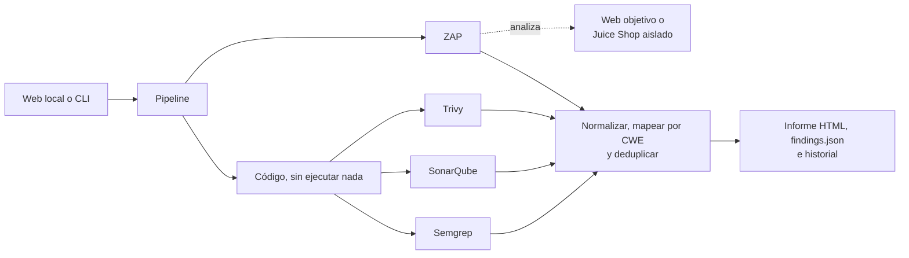
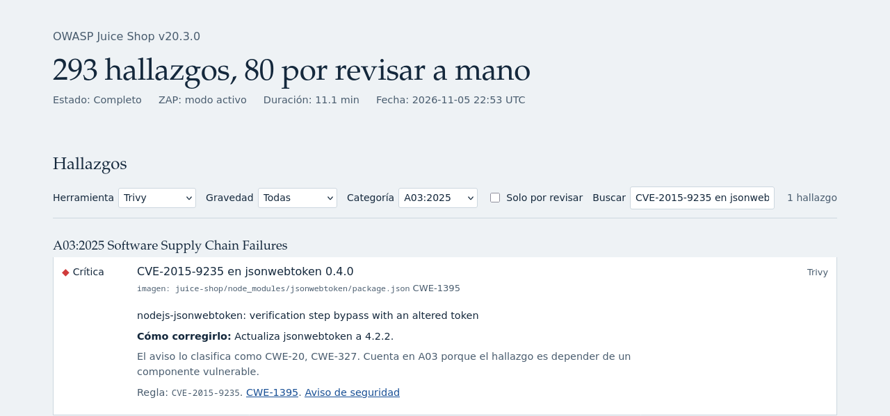

# Laboratorio AppSec

[](https://github.com/sergio-scardigno/laboratorio-appsec/actions/workflows/juice-shop-scan.yml)
[](LICENSE)

Pega una web o un repo y obtén un único informe de seguridad: **Semgrep y SonarQube** leen el código, **Trivy** busca dependencias vulnerables y secretos, **OWASP ZAP** prueba la web en marcha, y los hallazgos se agrupan por categoría del [OWASP Top 10:2025](https://top10.owasp.org/2025/0x00_2025-Introduction).


La idea que guía el informe es **distinguir "se miró y no hay nada" de "esta herramienta no puede verlo"**. Un análisis automático nunca demuestra que algo esté limpio.

> **In English:** a self-hosted lab that runs Semgrep, SonarQube, Trivy and OWASP ZAP against a repo or a website, normalizes the findings by CWE and maps them to the OWASP Top 10:2025 in one HTML report. OWASP Juice Shop is the reference target, isolated on a network with no way out. The documentation is in Spanish.

## Qué aporta

- **Un solo informe** para cuatro herramientas que no comparten formato, gravedad ni categorías.
- **Sin adivinar:** el mapeo sale del CWE y de la tabla oficial de OWASP. Lo que no encaja queda en "Sin mapear".
- **Sin falsa calma:** un cero, una herramienta que no se ejecutó y una que falló se ven distintos.
- **Autorización explícita** antes de enviar una sola petición a una web.
- **Pensado para código no confiable:** los repos analizados nunca se ejecutan y no pueden ocultarse sus propios hallazgos.

## Inicio rápido

Necesitas Ubuntu 24.04 con 4 vCPU, 8-12 GB de RAM y 50 GB de disco, preferiblemente en una VM dedicada.

```bash
git clone https://github.com/sergio-scardigno/laboratorio-appsec.git
cd laboratorio-appsec

# Como root, una sola vez: instala Docker y comprueba que arranca contenedores
sudo bash scripts/bootstrap-host.sh "$USER"
```

Abre una sesión nueva para que tu usuario pueda usar Docker y, desde la carpeta del proyecto:

```bash
make setup
make web
```

`make setup` crea `.env` con secretos aleatorios, levanta los servicios, cambia la contraseña de admin de SonarQube, genera su token y descarga imágenes, reglas y la base de vulnerabilidades. `make web` muestra un enlace con el token de acceso.

Para que la web arranque sola con la máquina, instálala como servicio, como root y una sola vez:

```bash
sudo bash scripts/install-web-service.sh "$USER"
```

Con el servicio, el enlace de acceso se consulta con `make web-url`.

La web solo escucha en `127.0.0.1`. Desde otro equipo, abre antes un túnel:

```bash
ssh -L 8000:127.0.0.1:8000 <usuario>@<host>
```

Pulsa **Analizar Juice Shop** para ver un informe completo en unos 10 minutos.


## Cómo funciona



Los escáneres son contenedores efímeros que corren en serie, con límites de memoria y tiempo. SonarQube, su base de datos y Juice Shop son servicios fijos.

| Entrada | Semgrep, SonarQube y Trivy | ZAP |
|---|---|---|
| Repo | Sí | No |
| Web | No | Sí, exige declarar autorización |
| Repo y web | Sí | Sí, exige declarar autorización |
| Preset Juice Shop | Sí, y Trivy analiza también su imagen | Sí, modo activo permitido |

### Mapeo al OWASP Top 10:2025

El CWE es el dato común a las herramientas, así que el mapeo siempre sale de él. La tabla `data/owasp2025_cwe.json` se genera desde las páginas oficiales de OWASP con `make owasp-map`, que falla si el número de CWE no coincide con el que declara cada página.

- **Sin CWE reconocible:** va a "Sin mapear".
- **Varios CWE:** el hallazgo cuenta en cada categoría que le corresponda, así que las filas suman más que el total.
- **Dos herramientas SAST coinciden** en archivo, CWE y línea (±3): cuenta como un hallazgo para ambas.
- **SAST y DAST con un CWE común:** se marca como correlación probable, sin fusionar. No hay un vínculo fiable entre una URL y una línea de código.
- **Trivy:** se mapea por la naturaleza del hallazgo. Una dependencia vulnerable es CWE-1395 (A03) y un secreto es CWE-798 (A07). Los CWE propios del aviso se muestran como información: usarlos pondría una dependencia con XSS en A05 y ocultaría el problema de la cadena de suministro.
- **Reglas `former-hotspot` de Sonar:** salen como "por revisar", porque dependen del contexto.
- **Una herramienta falla:** el análisis queda como parcial y el informe lo dice arriba del todo.

En cada ejecución se comprueba que, por herramienta, crudos = normalizados + descartados con motivo.

## Resultados sobre Juice Shop

Ejecución real con Juice Shop v20.3.0 y ZAP en modo activo: **293 hallazgos, 80 por revisar a mano**, en 11,1 minutos (4 vCPU, 12 GB de RAM).

| Categoría | Semgrep | SonarQube | Trivy | ZAP | Total |
|---|---:|---:|---:|---:|---:|
| A01 Broken Access Control | 10 | 35 | 0 | 4 | 49 |
| A02 Security Misconfiguration | 0 | 1 | 0 | 0 | 1 |
| A03 Software Supply Chain Failures | 7 | 0 | 125 | 0 | 132 |
| A04 Cryptographic Failures | 13 | 58 | 0 | 0 | 71 |
| A05 Injection | 22 | 14 | 0 | 1 | 35 |
| A06 Insecure Design | 5 | 0 | 0 | 5 | 10 |
| A07 Authentication Failures | 4 | 4 | 5 | 0 | 9 |
| A08 Software or Data Integrity Failures | 10 | 1 | 0 | 0 | 11 |
| A09 Security Logging & Alerting Failures | 0 | 5 | 0 | 0 | 5 |
| A10 Mishandling of Exceptional Conditions | 0 | 1 | 0 | 0 | 1 |
| Sin mapear | 8 | 1 | 0 | 2 | 11 |

Un hallazgo cuenta en cada categoría de sus CWE y para cada herramienta que lo detecta, por eso las columnas y las filas suman más que 293.

**El mismo fallo desde dos ángulos.** La inyección SQL del login aparece en el código (Semgrep, `routes/login.ts:34`) y en la web (ZAP, `POST /rest/user/login`), y queda marcada como correlación probable. SonarQube Community no la detecta.


**Dependencias.** Juice Shop no trae lockfile, así que analizar su repo no encuentra ninguna dependencia vulnerable. La imagen sí las tiene: Trivy detecta 125 vulnerabilidades, 79 en paquetes de Node y 46 en el sistema operativo, 11 de ellas críticas.



**Comprobado en esta ejecución:**

- Por herramienta, crudos = normalizados, sin descartes: Semgrep 72, SonarQube 85, Trivy 130 y ZAP 12.
- 18 vulnerabilidades de Trivy, elegidas al azar y entre las críticas, coinciden en paquete y versión con lo que hay dentro de la imagen. Eso confirma que el paquete está ahí, no que la vulnerabilidad sea explotable en esta aplicación.
- Una muestra aleatoria de 10 hallazgos de código, tomada en un análisis anterior con Semgrep y SonarQube, corresponde al código citado. Es una comprobación de esa muestra, no una tasa de falsos positivos.

**Lee estos números con cautela:**

- 80 hallazgos dependen del contexto; muchos son patrones como `Math.random()` que no siempre son un fallo. 293 no significa 293 vulnerabilidades explotables: una dependencia vulnerable solo importa si la aplicación usa la parte afectada.
- ZAP no es determinista: en cuatro análisis activos dio 12, 12, 14 y 12 alertas, con alguna distinta. La inyección SQL apareció en los cuatro, con confianza baja según el propio ZAP.
- ZAP informó de peticiones sin respuesta (4 %, 11 %, 50 % y 51 %). Es una cifra global: Juice Shop no se reinició y siguió respondiendo, y desde su red aislada no se llega a dominios externos, pero el dato no permite descartar otras causas.
- 43 archivos se analizaron de forma parcial en Semgrep, muchos de ellos fragmentos de ejercicio de `data/static/codefixes`.

## Uso

### CLI

```bash
# Juice Shop: código + web, con ataque real
.venv/bin/lab scan --preset juice-shop --active

# Un repo público
.venv/bin/lab scan --repo https://github.com/OWASP/NodeGoat

# Una web tuya, en modo pasivo
.venv/bin/lab scan --url https://mi-web.example --i-am-authorized

# Una web tuya, atacándola
.venv/bin/lab scan --url https://mi-web.example --i-am-authorized --active --confirm-active

# Como puerta de calidad en una app real
.venv/bin/lab scan --repo https://github.com/org/app --fail-on high

# Historial
.venv/bin/lab runs
```

Códigos de salida: `0` correcto, `1` superado `--fail-on`, `2` parcial o con error, `3` rechazado.

Cada análisis deja en `runs/<id>/` el informe `report.html`, los datos en `findings.json` y la salida cruda de cada herramienta.

### Repos privados de GitHub

1. Crea un [token fine-grained](https://github.com/settings/personal-access-tokens/new) con acceso solo a los repos que quieras analizar y un único permiso: **Contents: Read-only**. Ponle caducidad.
2. Añádelo a `.env`, que solo puede leer tu usuario:
   ```bash
   echo 'LAB_GITHUB_TOKEN=github_pat_...' >> .env
   ```
3. Reinicia `make web` si estaba en marcha. La CLI lo lee en cada análisis.

El token solo se envía a `github.com`, nunca a otros hosts. Va a git por variables de entorno, no en la URL ni en argumentos visibles con `ps`, y no queda en `request.json` ni en el historial. El código privado se envía solo a tu SonarQube local, pero el informe y `runs/<id>/` incluyen fragmentos de ese código: trátalos como privados.

### Control antes del push

Un hook `pre-push` global hace que todo lo que subas desde tu equipo, a GitHub o a cualquier remoto, pase antes por dos controles. Si uno falla, el push no sale.

1. **Autoría**, en tu equipo y en segundos, sobre cada commit nuevo:
   - firmado con tu clave SSH;
   - autor y committer con tus emails;
   - sin coautores que no seas tú;
   - sin marcas de agentes de IA en el mensaje, como `Co-Authored-By: Claude` o `cursoragent@cursor.com`;
   - sin carpetas ni archivos de agentes, como `.claude/`, `.cursor/`, `CLAUDE.md` o `AGENTS.md`, ni en lo que se sube ni en ningún commit nuevo.

   La lista está en [`client/agent-patterns.txt`](client/agent-patterns.txt).
2. **Seguridad**, en el laboratorio: Semgrep, SonarQube y Trivy analizan el commit que se sube, no tu carpeta de trabajo. Trivy también revisa el diff de los commits nuevos, porque un secreto borrado en un commit posterior se publica igual. Bloquean los hallazgos **críticos, altos y cualquier posible secreto** que no estén en la línea base del repo. ZAP no participa: en un push no hay una web en marcha.

Instalación en tu equipo, que puede ser Linux, macOS o Git Bash en Windows:

```bash
bash client/install.sh --host usuario@laboratorio --email tu@correo --email 12345+usuario@users.noreply.github.com
```

El script:

- instala el hook y el comando `git gate`;
- configura la firma de commits con SSH;
- agrega las rutas de agentes a tu gitignore global;
- crea una clave `~/.ssh/appsec_gate` sin contraseña, que solo sirve para la puerta.

Al terminar, te indica la línea que va en `~/.ssh/authorized_keys` del laboratorio. También puedes agregarla con `ssh usuario@laboratorio appsec-lab/scripts/add-gate-key.sh < ~/.ssh/appsec_gate.pub`. Esa línea fuerza `scripts/gate-ssh.sh` con `restrict`, así que la clave no da shell ni permite túneles. También tienes que subir tu clave de firma a GitHub como *Signing key*.

Cuando el análisis bloquea, el informe se guarda en `~/.cache/appsec-gate/`. Corrige el problema, o acepta los hallazgos con un motivo; se aceptan en el laboratorio, no en tu repo:

```bash
git gate accept <run_id> "falso positivo: es un dato de prueba"
git gate list
```

Si el laboratorio no responde, el push también se bloquea.

Límites:

- **La puerta vive en tu equipo:** `git push --no-verify`, o empujar desde otra máquina, se la salta. Activa *Require signed commits* en la rama principal de GitHub para que allí también se exija la firma.
- **Solo ve marcas declaradas:** trailers, autores y archivos. No puede saber si el código de un commit tuyo y firmado lo escribió un agente.
- **Repos con su propio `core.hooksPath`,** como los que usan husky, no ejecutan el hook global.
- **Desactivar el análisis en un repo:** `git config appsec.scan false`. La revisión de autoría se aplica igual.
- **Tiempo:** cada push con commits nuevos tarda lo que un análisis de repo, entre 1 y 3 minutos. Si hay otro análisis en curso, espera hasta 15 minutos.

Las pruebas del cliente usan repos y un `HOME` temporales: `bash client/tests/test-policy.sh`.

### Como servicio

`scripts/install-web-service.sh <usuario>` instala la web como servicio de systemd, a partir de la plantilla de `deploy/`. El enlace con el token no queda en el journal: se consulta con `make web-url`.

### En un contenedor LXC de Proxmox

Funciona en un LXC sin privilegios (probado con el kernel `7.0.2-6-pve` y Docker 29.9.3), con estas opciones en el host:

```bash
pct set <id> --features nesting=1,keyctl=1
pct resize <id> rootfs 50G
pct reboot <id>
pct exec <id> -- bash /ruta/a/appsec-lab/scripts/bootstrap-host.sh <usuario>
```

Después de `make setup`, el servicio se instala desde el host con:

```bash
pct exec <id> -- bash /ruta/a/appsec-lab/scripts/install-web-service.sh <usuario>
```

Una VM aísla mejor: en un LXC, este entorno comparte kernel con Proxmox mientras analiza código ajeno y ejecuta una aplicación vulnerable.

## Solo analiza lo que tengas permiso de analizar

ZAP envía peticiones reales incluso en modo pasivo, y en modo activo ataca: puede alterar datos o tumbar la web. Analizar sitios ajenos sin permiso puede ser ilegal.

Por eso cualquier web distinta del preset exige declarar autorización, el modo activo exige una segunda confirmación, y ambas quedan registradas. El laboratorio no puede comprobar que esas declaraciones sean ciertas: la responsabilidad es de quien lo usa.

## Seguridad del propio laboratorio

**Repos no confiables**

- Clonado superficial, sin hooks ni submódulos, y solo por `https://`. Nunca se compila ni se ejecuta nada.
- Se borran `.semgrepignore`, `sonar-project.properties`, `.trivyignore`, `trivy.yaml` y `trivy-secret.yaml`, y Semgrep corre con `--disable-nosem` y `--no-git-ignore`, para que un repo no pueda ocultarse sus propios hallazgos. Los comentarios `NOSONAR` sí pueden silenciar a SonarQube.
- Escáneres con el código en solo lectura, `--cap-drop ALL`, `no-new-privileges` y límites de memoria y procesos. Semgrep corre sin red.

**Trivy**

Trivy sufrió un [ataque de cadena de suministro en marzo de 2026](https://github.com/aquasecurity/trivy/security/advisories/GHSA-69fq-xp46-6x23): sus versiones 0.69.4, 0.69.5 y 0.69.6 robaban credenciales. Por eso:

- Está fijado por digest a una versión posterior, y ese digest coincide en Docker Hub y en GHCR.
- Actualizar la base necesita red, pero no ve el código. Analizar ve el código, pero corre sin red.
- Ninguno de los dos recibe secretos ni el socket de Docker. La imagen del preset llega como una copia con `docker save`.
- El valor de los secretos que detecta no se guarda: ni en el informe ni en `runs/`.

**Exposición**

- Web y SonarQube solo en `127.0.0.1`.
- La web exige token, valida `Host` y `Origin` frente a DNS rebinding y CSRF, y usa una cookie `HttpOnly` y `SameSite=Strict`.
- Juice Shop va en una red `internal`, sin salida a internet ni a la LAN.
- El informe escapa todo el contenido analizado, lleva una CSP con nonce y no copia el código de los posibles secretos.

**Riesgo aceptado:** quien pertenece al grupo `docker` equivale a root en el host. Por eso el host debe dedicarse a esto.

## Límites

- **Dependencias (A03):** Trivy solo las ve en repos con lockfile, o en la imagen del preset. Sin lockfile no genera uno ni compila, y el informe lo avisa. No se pueden analizar imágenes arbitrarias, y nada comprueba la procedencia de los componentes.
- **Diseño y registros (A06 y A09):** apenas se detectan con escáneres.
- **SonarQube Community:** no hace análisis de flujo; no detecta la inyección SQL de `routes/login.ts`.
- **Secretos por patrones:** en un repo de prueba, ninguna de las herramientas que leen código detectó una contraseña escrita en una constante (`const password = "..."`). SonarQube y Trivy sí detectaron un token con formato reconocible.
- **ZAP sin autenticación:** no llega a lo que está detrás del login.
- **Limpieza:** cada análisis deja un proyecto en SonarQube y su carpeta en `runs/`; no se borran solos.

## Desarrollo

```bash
make test         # Tests con salidas reales recortadas (tests/fixtures)
make test-client  # Tests del hook pre-push, con repos y HOME temporales
make owasp-map    # Regenera la tabla CWE -> OWASP
```

El workflow `.github/workflows/juice-shop-scan.yml` ejecuta los tests y un análisis completo de Juice Shop al subir código a `main`, cada semana y de forma manual, y sube el informe como artifact. Falla solo si una herramienta falla: que Juice Shop tenga hallazgos es lo esperado.

## Cómo se construyó

Este laboratorio se construyó con ayuda de [Claude Code](https://claude.com/claude-code), que aparece como coautor en el historial de commits.

## Licencia

El código de este repo se publica bajo [licencia MIT](LICENSE).

Las reglas de Semgrep tienen su propia [licencia](https://semgrep.dev/legal/rules-license), que no permite redistribuirlas ni ofrecerlas como servicio. Por eso se descargan en la instalación y no están en este repo.
